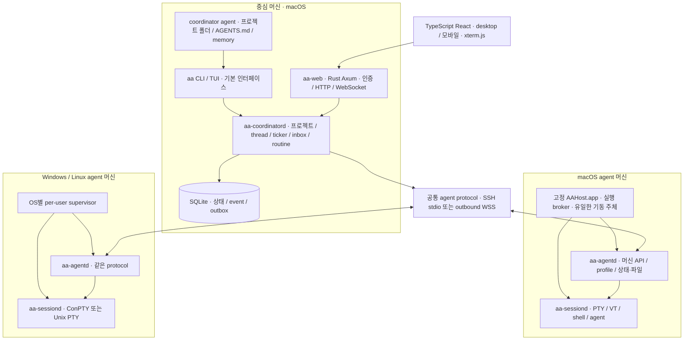

# aa 조사·개발 계획

2026-10-16 · **조사·계획 완료, 사용자·coordinator 검토 대기**. 이 문서는 구현 승인이나 개발자 도구 문제 해결 완료를 뜻하지 않는다. 고정 버전의 분석은 [소스 분석](source-analysis.md), 실측과 미검증 조건은 [실험 기록](experiments.md)에 있다.

## 결론

1. herdr의 PTY·세션 관리, **projects 0.2.x의 프로젝트 폴더·coordinator·ticker·inbox·routine·thread·profile**, web-ui의 모바일 terminal 경험을 하나의 Rust API 위에 묶는다.
2. 중심 머신은 macOS, agent 실행 머신은 Windows·macOS·Linux다. CLI가 기본이며 웹은 같은 API를 쓰는 선택적 client다.
3. Rust/Tokio·portable-pty·ghostty-vt adapter·Ratatui·SQLite, Rust/Axum 웹 서버와 TypeScript/React/Vite/xterm.js를 추천한다. 원격은 SSH와 SSH 없는 머신의 outbound WSS를 함께 설계한다.
4. 개발자 도구 문제는 **고정 AAHost.app가 실행 책임을 소유하고 버전별 core와 분리되는 구조**를 우선 검증한다. 미등록 앱은 실제로 +221.609~236.280ms 느렸으며, 일회 등록 후·업그레이드·재부팅 합격은 아직 가설이다.
5. 필요한 유닛·실제 PTY/ConPTY·세 OS agent E2E·Mac 중심 머신 E2E·헤드리스 웹 검증을 완료 기준으로 둔다. 성능 gate가 모두 통과하기 전 현 운영을 이전하지 않는다.

## 1. 범위·전제

사용자 지정 범위는 **「macOS만 = coordinator·ticker·웹 서버가 도는 중심 머신, Windows·macOS·Linux = agent가 도는 머신」**이다. 중심은 지금의 mac-b처럼 한 머신의 프로젝트 폴더·AGENTS.md·memory를 기준으로 한다. herdr-projects는 v0.2.35까지의 형태만 참고했다. 중심 머신 자체도 macOS agent 실행부를 통해 local thread를 실행할 수 있다.

고정 언어는 Rust 기본, 웹 TypeScript다. 웹 서버는 Rust로 만들고 TypeScript는 브라우저 코드·웹 도구에 쓴다. Bun runtime은 필수 설치 요소로 두지 않는다. OS 범위·추천 스택·아래 제안 경로와 명령은 변경 가능한 계획이므로 AGENTS.md에 넣지 않는다.

| 항목 | 이번 설계의 범위 |
|---|---|
| 중심 머신 | macOS, 단일 사용자·단일 권위 coordinator 상태 저장소; 프로젝트별 coordinator agent |
| agent 머신 | macOS arm64/x64, Linux x64/arm64, Windows x64의 native 실행을 설계; Windows arm64 배포는 후속 검증 |
| Windows 기준 | ConPTY 가능한 지원 버전부터; 우선 Windows 11 x64 native CI·실기기. WSL로 Windows 지원을 대신하지 않음 |
| macOS 기준 | SMAppService 가능한 macOS 13 이상을 후보로 두되 실제 지원 하한은 서명·성능 gate에서 확정; 현재 운영 27.x 검증 필수 |
| Linux 기준 | glibc 환경 우선, bash/zsh·systemd 없는 경우도 수동 per-user supervisor 가능; musl/배포판 확대는 별도 검증 |
| 원격 | 기존 세 Mac은 SSH, SSH 서버 없는 Windows 등은 agent가 중심으로 outbound TLS 연결 |
| 웹 | desktop·모바일, authenticated read/control, terminal·보고·inbox·routine·profile 표시; CLI와 기능 의미 동일 |
| 복원 | 네트워크/client/관리 daemon 재접속 시 기존 실행 유지; OS 재부팅 이후는 layout·agent 대화 재개, 중단한 빌드를 성공으로 처리하지 않음 |
| 이번 작업 | 문서·웹 보고서·격리 소규모 실험만. 제품 코드, 설치·권한·운영 서버·agent 설정 변경 없음 |

초기 비목표: 다중 사용자 SaaS, agent 자체 모델 API 대체, 임의 플러그인 marketplace, 외부 gateway/WebRTC/QUIC, 완전한 tmux 명령 호환. 세 OS **agent** 지원은 비목표가 아니며 첫 실행부부터 반영한다.

## 2. 세 도구에서 취할 것

| 도구·확보 버전 | 좋은 점·가져올 개념 | 줄이거나 버릴 점 | 라이선스·이용 방식 |
|---|---|---|---|
| herdr 0.9.5 `2ecf19a` | 실제 PTY, workspace/tab/pane, detach/attach, terminal identity, snapshot/event, integration/session restore, machine 선택 | 원격/web가 먼저 서버를 띄우는 경합, GUI 터미널 수명에 의존한 권한, 내부 wire enum 종속 | Apache-2.0, 선택적 재사용 시 고지·수정 표시·NOTICE 확인 |
| projects 0.2.35 `1f05c00` | 프로젝트 폴더·AGENTS/memory, coordinator의 판단과 binary의 절차 분리, profile, ticker/inbox/routine, worktree·report·sidebar, `herdr --machine` | 매 요청 CLI/SSH 실행, 원격 tab/checkout 제한, polling·파일 상태의 중복, POSIX 원격 스크립트 | MIT, 고지 보존; domain 개념과 검증된 작은 로직 중심 |
| web-ui 0.4.10/v29 `aa624cb` | React/xterm terminal, 모바일 composer·IME, chat/terminal 전환, 장치 권한, ACK/backpressure, 원격 연결 표시 | Bun→Node→herdr 층, 웹이 실행 서버를 임의 기동, vendor별 transcript 전체를 MVP에 복제 | MIT, 고지 보존; UI 패턴·선택적 component 참고 |
| 보조 mobile-relay 0.21.3 `a58f1fc` | 장치별 취소·controller/reader, 불안정 연결 복구 관점 | 외부 gateway·NAT·WebRTC를 초기 범위로 확대하지 않음 | AGPL-3.0-or-later, 제품 코드에 혼합하지 않고 일반 개념만 참고 |

원본 URL·전체 commit·코드 근거·각 구조도는 [소스 분석](source-analysis.md)에 보존했다. mac-a 설치 v29의 TS server 파일 100개가 공개 소스와 모두 일치한다. mac-b의 mobile-relay는 web-ui와 다른 프로그램이다. 현재 aa의 원격 초기 MIT LICENSE는 이력을 보존하여 유지했다.

## 3. 목표 기능과 사용자 흐름

| 영역 | 목표 기능 | 사용자가 확인할 결과 |
|---|---|---|
| 프로젝트·coordinator | 프로젝트 폴더의 AGENTS.md·memory·TASKS.md, coordinator session, context·inbox cursor | 놓친 알림도 context에서 다시 읽음; 시작 profile·실제 세션 식별 가능 |
| thread | worktree/tab/checkout 또는 원격 task dir, profile, brief, 보고, review/ack/resolve | repo 없는 원격 작업도 가능; report가 검토 대기로 보존됨 |
| 여러 머신 | 머신 등록·상태·능력·profile, `--machine`, 단절/복귀 | 단절 중 thread를 failed/done으로 오판하지 않음; remote work 유지 |
| 감시·routine | event 기반 상태 감시, 주기적 reconciliation, 일정·알림·허용된 명령 | 중복 알림 억제, 실행 ID와 누락된 일정 표시, explicit 실패 |
| 세션 | 이름 있는 session, workspace/tab/pane, split/resize/scrollback, 여러 client·detach/attach | client 종료·SSH 끊김·웹 재시작으로 pane이 죽지 않음 |
| 복원·갱신 | 실행 중 pane 재attach, versioned launch/resume spec, 재부팅 후 agent resume | model·effort·권한 의도가 기록됨; 실행 중이던 build는 interrupted로 남음 |
| 웹·모바일 | terminal, 상태·보고·inbox·routine, 읽기/조작 구분, 모바일 입력·한글 IME | 모바일 background tab이 PTY 크기를 빼앗지 않음; 보고서와 조작이 분리됨 |
| 운영·진단 | `doctor`, machine health, responsible/signature/키체인 상태, 버전·프로토콜 | 빠르지만 키체인이 잠긴 상태도 건강 실패로 표시 |

명령 형태의 예시는 `aa project context`, `aa thread start --machine M --profile P --task-file F`, `aa pane run/read/keys`, `aa session attach/detach`, `aa machine list`, `aa web serve`다. 이는 **설계 예시이며 현재 실행 가능한 명령은 아니다**. 명령마다 JSON 출력·안정된 error code·exit code를 정의한다. `pane run`의 셸 문자열 실행과 구조화된 `process start(argv)`를 분리하여 원격 OS의 셸 인용을 제어 흐름으로 사용하지 않는다.

## 4. 프로세스와 모듈



이름은 역할을 표현한 제안이다. aa CLI·coordinatord·agentd·web는 공통 Rust workspace의 subcommand 또는 별도 executable로 패키징하되 역할·권한·수명은 분리한다. web 재시작은 coordinator와 session에 영향을 주지 않는다. ticker는 중심 daemon 안의 명시적인 task로 두어 projects의 역할을 유지하면서 또 하나의 중복 상태 소유자는 만들지 않는다.

**실행부를 먼저 분리한다.** 관리 daemon은 오래 사는 session host에 연결한다. session host가 PTY master·child handle·VT state를 소유한다. 관리 daemon 갱신은 session host를 종료하지 않는다. 활성 session은 해당 세션의 실행부 버전을 계속 쓰고, 신규 session부터 새 버전을 선택한다. session host 자체 업그레이드는 drain 또는 명시적 재시작으로 처리하며 이를 무중단이라고 부르지 않는다. 재부팅 뒤 기존 OS 프로세스가 살아 있다고 약속하지 않는다.

macOS에서는 고정 app broker가 agentd/sessiond를 직접 생성하여 책임 계보를 통제한다. 중간 web·sshd·관리 daemon이 자체 fallback server를 만들지 못하게 한다. broker가 단일 인스턴스 lock과 인증된 local IPC로 시작 요청을 합친다. 앱 자동기동/요청 기동과 helper 장애 후 책임 유지까지 실증해야 이 구조를 채택할 수 있다. 단순 launchd SID 판정은 사용하지 않는다.

프로젝트·thread domain, agent adapter(Claude/Codex), process/PTY adapter, transport, state store, TUI, web를 라이브러리 경계로 나눈다. 초기에는 동적 플러그인 ABI를 만들지 않고 내장 adapter로 시작한다. 뒤에는 manifest+외부 프로세스 RPC 확장을 고려하되 빌드·설치 자동 실행은 별도 기능으로 다룬다.

## 5. 세 OS 실행부

| 차이 | macOS | Linux | Windows native |
|---|---|---|---|
| 터미널 | Unix PTY·tty·SIGWINCH | Unix PTY·tty·SIGWINCH | ConPTY·ResizePseudoConsole·별도 input/output pump |
| 프로세스 수명 | 고정 app broker·GUI 보안 session, session host | per-user supervisor, systemd user unit 선택, 없으면 명시 foreground supervisor | user-logon Task Scheduler의 supervisor 후보; SSH/Bun job에서 독립 기동·검증 |
| 종료·자식 관리 | PID+시작 identity 확인, process group 소유 추적 | 같은 원칙 | process handle+creation time, Job Object는 session host가 소유; Cancel/CTRL event·종료 fallback 의미 분리 |
| 셸 | 사용자 기본 zsh/bash, argv 실행 우선 | 사용자 shell, argv 실행 우선 | PowerShell/pwsh/cmd 종류 명시, CreateProcessW 인용·UTF-16 경로 |
| 경로·환경 | POSIX path·HOME, 외장 볼륨 권한 | POSIX bytes path·HOME, locale | drive/UNC·backslash·APPDATA/LOCALAPPDATA·대소문자·UTF-16 |
| 줄바꿈·문자 | LF와 raw terminal bytes | 동일, locale 검증 | CRLF·codepage/UTF-8·ANSI, 단순 LF 치환 금지 |
| local IPC | user-only UDS·peer UID | user-only UDS·peer UID | user SID 제한 Named Pipe·ACL |
| 인증 저장 | GUI 로그인 키체인 접근 검증 | 파일 권한·OS keyring 선택 | 사용자 DPAPI/Credential Manager 후보, interactive user와 service 계정 구분 |
| SSH | 시스템 ssh, known_hosts | OpenSSH, 배포판 차이 | OpenSSH optional; 없으면 outbound WSS |
| macOS 실행 검사 문제 | 별도 필수 gate | 해당 없음 | 해당 없음; AV/SmartScreen·서명은 별도 성능 관측 |

portable-pty의 API가 있다는 것만으로 전체 수명 관리가 해결되지는 않는다. Windows의 handle·job·ConPTY 입력/출력 deadlock, 부모 SSH 종료 뒤 생존은 native E2E로 확인한다. [Microsoft ConPTY 문서](https://learn.microsoft.com/en-us/windows/console/creating-a-pseudoconsole-session)는 동기 I/O 채널을 별도 thread에서 처리하도록 설명한다. wrapper 안에 blocking PTY reader/writer를 두고 Tokio event loop를 막지 않는다.

Windows 기본을 Session 0의 시스템 서비스로 잡지 않는다. 사용자 자격 증명·agent 로그인·대화형 앱과 다른 보안 세션이기 때문이다. user-logon supervisor를 첫 후보로 하고, 로그인 전 서비스 실행까지 필요한지는 별도 결정한다. Linux systemd user·Windows Task Scheduler·macOS login item은 **설치·운영 단계의 제안**이고 이번 작업에서 등록하지 않았다. 해당 서비스가 없는 환경에서는 명시적 supervisor를 실행할 수 있으나 자동 복구 보장 수준을 표시한다.

머신 경로는 항상 `(machine_id, os, native_path)`로 저장한다. 중심 Mac의 PathBuf로 Windows 경로를 canonicalize하지 않는다. control API는 Unicode 경로를 기본으로 하고 Unix 비UTF-8 경로는 명시적으로 지원 불가 오류 또는 별도 bytes encoding을 선택한다. 실행 env는 machine-local profile에서 해석하며 HOME·PATH·드라이브를 중심 값으로 덮어쓰지 않는다. 파일 전송에서 절대 경로·상위 이동·symlink/junction을 검증한다.

## 6. 상태·API·원격 연결

### 상태 소유권

중심의 SQLite가 project/thread/profile snapshot·inbox/routine·보고 receipt·원격 연결 관측의 권위다. 각 agent의 local SQLite는 자신의 실행·세션 manifest·command receipt·outbox를 소유한다. SQLite 파일을 SMB/NFS로 공유하지 않는다. WAL·transaction·단일 write task로 동시 접근을 관리한다. Markdown/TOML은 사람이 읽고 agent가 쓰는 문맥으로 유지한다.

```text
중심의 사용자 데이터 영역(제안)
  state.sqlite3, config.toml, machine identities
  projects/<project>/AGENTS.md, PROJECT.md, TASKS.md, MEMORY.md, memory/, routines/
  projects/<project>/threads/<id>/brief.md, report.md, library/
머신별 사용자 데이터 영역
  state.sqlite3, sessions/<session-id>/manifest.json, bounded output logs
  worktrees 또는 task dirs/.aa/<project>/<thread>/brief.md, report.md, library/
macOS 고정 실행부(제안)
  /Applications/AAHost.app                       설치 뒤 고정
  사용자 데이터 영역/aa/releases/<version>/      교체 가능한 core
```

중복된 file/DB 상태를 임의로 양쪽에서 수정하지 않게 한다. profile·project config는 revision과 원본 hash를 가진 입력이고 DB는 이를 파싱한 snapshot을 저장한다. report.md는 thread가 쓰는 원본, 중심의 report는 검증된 사본이다. inbox Markdown 투영의 처리 상태는 API ack로 변경한다. 파일 감시가 실패해도 reconciliation이 변경 hash를 다시 찾는다.

thread의 `launch_state`(planned/starting/running/exited/failed/interrupted), `agent_state`(unknown/working/blocked/idle), `review_state`(none/ready/acknowledged/resolved), `connection_state`를 분리한다. 오래된 관측은 last_seen/stale로 표시한다. agent idle 또는 100% progress만으로 검토·완료·merge를 자동 확정하지 않는다.

### 공통 API

Rust typed request/event와 JSON Schema로 TypeScript 타입을 생성한다. 제어 plane은 길이 제한을 가진 versioned JSON, terminal plane은 seq·offset·ACK가 있는 binary payload로 분리한다. bincode enum 순서나 Rust 메모리 구조를 공개 wire 계약으로 노출하지 않는다.

주요 영역은 project/context, thread/start/prompt/report/ack/resolve, machine/capabilities/profiles, session/workspace/tab/pane, terminal/attach/input/resize, events/subscribe, routine/approve/run이다. local은 UDS/Named Pipe, remote는 동일 envelope의 SSH stdio/WSS다. 웹에는 `/api/v1`의 resource endpoint와 `/ws` terminal/event stream을 제공한다.

envelope에는 protocol major·minor, request ID, machine ID·boot ID, object ID, command ID, deadline, revision을 둔다. hello에서 기능을 협상하고 알 수 없는 선택 필드는 무시하되 필수 기능 부재는 명시 오류로 돌려준다. boot가 달라진 오래된 pane 입력, unknown major, 초과 frame, 잘못된 offset은 거부한다. client의 cursor가 보존 범위 밖이면 snapshot 후 이어진 event를 보낸다.

outbox/receipt로 state change와 전달 상태를 원자적으로 저장한다. 동일 command ID의 재연결은 결과 조회로 처리한다. 터미널 타이핑과 외부 agent의 실제 접수까지 완전한 exactly-once를 주장하지 않는다. 접수 확인 없이 연결이 끊기면 `delivery_unknown`으로 남기고 **prompt·keys·shell command를 자동 재입력하지 않는다**. 전송 재접속과 작업 재실행은 다른 절차다.

여러 client는 독립 viewport를 갖되 실제 PTY 크기는 pane의 조작 lease 소유자가 정한다. observe client는 입력·resize를 할 수 없다. 제어 전환·lease expiry는 서버가 판정하고 입력 직전에 재확인한다. 느린 client는 bounded queue에서 snapshot으로 재동기화하며 전체 agent를 무기한 backpressure하지 않는다. 출력 로그·스크롤백 상한, frame 상한·rate limit은 설정 가능한 정책으로 둔다.

### 원격 등록·설치·갱신

기존 세 Mac에는 SSH key·known_hosts를 재사용한다. 연결 명령은 remote supervisor에게 연결하거나 **정해진 broker에 시작을 요청**할 뿐, SSH 안에서 임의 daemon을 만들지 않는다. shell 부트스트랩은 OS 식별·고정 executable 경로 실행까지만 한정한다. Windows의 PowerShell/cmd 인용은 OS adapter가 담당하며 이후 모든 지시는 typed frames로 전송한다.

SSH 없는 머신은 OS별 agent package를 한 번 설치하고 짧은 enrollment code로 중심 fingerprint를 확인한 뒤, agent가 outbound WSS로 접속한다. 장치별 key를 발급·취소하고 pin 또는 client certificate로 상호 식별한다. 본 연결에서는 short code를 다시 보내지 않는다. 중심에 접근 가능한 LAN/VPN/명시 TLS endpoint가 전제이며 NAT gateway를 새로 운영하지 않는다. SSH도 없고 중심에 outbound 접근도 없으면 현재 설계로 연결할 수 없다고 표시한다.

원격 설치는 OS/arch별 서명 package·hash/manifest 검증 → 사용자 데이터 디렉터리의 새 version staging → self-check → atomic switch(Windows는 실행 파일을 덮어쓰지 않고 다른 directory) 순서다. 관리자 설치·SSH 서비스 추가는 필수가 아니다. 기존 실행부를 종료하는 자동 update는 하지 않는다. 프로토콜 호환 범위 내에서 단계별 갱신하고, rollback은 DB schema와 기존 session 버전을 함께 고려한다. 다운로드 실패·서명 실패를 무시한 fallback 설치는 없다.

### profile·hook·보고

profile은 이름, agent kind, model, effort, argv, env 참조, resume 방식, OS별 shell을 가진다. 원격에서 해석한 결과와 revision을 thread에 저장하고 중심 허용 목록과 원격 실행 정책 양쪽에서 검증한다. restart/resume 때 profile이 바뀌었으면 기존 snapshot 사용 또는 명시 갱신 중 하나를 선택한다. 권한 관련 launch intent도 보존하지만 실제 agent CLI의 현재 지원·trust 절차를 우회하지 않는다.

Claude/Codex adapter는 semantic hook을 우선하고 process 생존·screen heuristic을 보조로 둔다. hook이 없거나 신뢰가 보류됐으면 unknown/stale 상태를 솔직히 표시한다. 동일 session ID·boot ID·한정 token으로 잘못된 pane의 상태 보고를 차단한다. native `aa hook`가 작은 bounded JSON을 로컬 IPC로 전달하여 매 hook마다 Python·shell·SSH 체인을 만들지 않는다. transcript parsing/chat 기능은 최소 read-only부터 추가하고 버전별 fixture로 검증한다.

report는 hash가 다른 파일을 임시 경로로 받아 크기·hash를 검증한 뒤 atomic publish한다. library 전송에는 상대 경로·digest·길이 manifest, partial receipt·재개 offset을 둔다. symlink/junction을 따라 임의 파일을 읽지 않는다. 보고 파일이 복사됐다고 모든 artifact가 복사됐다고 가정하지 않는다. resolve는 최종 receipt와 dirty worktree 검사를 통과해야 하며 실패한 회수는 worktree를 보존한다.

## 7. 보안·신뢰 경계

- local IPC는 user-only directory/socket와 peer UID/SID를 확인한다. PID 문자열만 믿지 않고 시작 identity 또는 OS handle로 대상 프로세스를 확인한다. 명령별 대상 project/machine/session 권한을 검증한다.
- 웹은 기본 loopback bind다. localhost에서도 pairing/session 인증을 적용한다. 장치별 reader/controller, 취소·만료·로그아웃, HttpOnly/SameSite cookie, HTTPS의 Secure, Origin/CSRF 검사를 구현한다. 외부 bind는 TLS와 명시 인증이 있어야 시작된다.
- Tailscale은 연결 경로의 선택지다. 임의 proxy가 보내는 identity header를 신뢰하지 않는다. SSH known_hosts 검증을 끄지 않는다. token은 URL·로그·HTML 보고서에 넣지 않는다.
- 웹 권한 취소·lease 변경을 이미 열린 WebSocket·대기 입력에도 반영한다. reader는 resize·keys·routine 실행이 불가능해야 한다.
- agent가 만든 HTML/Markdown·terminal OSC·파일 링크는 신뢰하지 않는다. 보고서는 sanitize 또는 별도 origin의 sandbox iframe으로 표시하고 제어 UI와 같은 origin에서 script를 실행하지 않는다. 파일 열기는 machine-local allow-root 검증을 거친다.
- profile·routine 승인은 configuration revision과 정확한 명령 digest에 묶는다. agent와 coordinator는 동일 사용자 계정의 shell을 가질 수 있으므로 이것을 강한 sandbox라고 주장하지 않는다. 보안 격리가 필요하면 별도 OS 계정/VM 단계가 필요하다.
- 고정 broker는 임의 경로 실행 프록시가 되지 않게 검증한 release manifest와 제한된 실행 요청만 받는다. 최소 기능·고정 ABI·서명 배포로 유지한다. broker 보안 패치가 필요할 때 재등록 없이 갱신 가능한지도 별도 release gate로 둔다.

## 8. 개발자 도구·속도 해결 계획

사용자 합격 기준은 **설치 때 한 번 등록까지 허용, 업그레이드 재등록 없음, 매번 GUI 터미널 선행 실행 없음, 재부팅 후 ssh/web 우선 접속에도 빠름, 키체인 잠김 없음**이다. 이 기준을 완화한 우회책을 채택하지 않는다.

실측 요약(n=6/조건):

| 실험 | 첫 실행 평균 ms | warm 평균 ms | 추가 지연 ms | 키체인 | 의미 |
|---|---:|---:|---:|---|---|
| 기존 WezTerm 책임 상속 | 1.962 | 1.824 | 0.138 | unlocked | 빠른 기준선, 운영 해결안으로는 탈락 |
| setsid만 적용 | 1.749 | 1.638 | 0.111 | unlocked | SID 분리가 책임 계보를 바꾸지 않음 |
| disclaim=true | 225.950 | 1.966 | 223.984 | unlocked | 미등록 child 자신의 책임 → 느림 |
| 미등록 GUI app | 227.043 | 5.434 | 221.609 | unlocked | GUI 형태만으로 면제 안 됨 |
| 등록된 sshd-session 아래 | 1.767 | 1.677 | 0.090 | **locked** | 빠르더라도 전체 합격 아님 |
| SSH → LaunchServices 미등록 app | 241.976 | 5.696 | 236.280 | unlocked | GUI 로그인 후 키체인 경로 후보, 속도 미합격 |

다음 표의 `가설`은 실패한 셀을 성공으로 가정했다는 뜻이 아니라 **측정 전이므로 합격 판정 불가**라는 뜻이다. 세부 표·모든 60개 표본은 [실험 기록](experiments.md)에 있다.

| 후보 | 한 번 등록 | 업그레이드 유지 | 재부팅·ssh/web-first 빠름 | 키체인 무잠김 | 종합 |
|---|---|---|---|---|---|
| WezTerm 의존 | 현재 등록 | child 변경은 빠름 | 터미널 선행·생존 의존 | 순서 의존 | 탈락(+0.138ms 기준선) |
| sshd 아래 서버 | 현재 등록 | 새 앱 보장 아님 | 현재 SSH만 빠름 | **실측 locked** | 탈락(+0.090ms) |
| setsid/disclaim만 | 면제를 만들지 못함 | 책임자/binary에 의존 | 미등록 경로 느림 | 보안 session을 고치지 못함 | 단독 탈락(+223.984ms) |
| 고정 경로의 교체 launcher | 등록 정체성 별도 | **adhoc 재빌드 DR 변경** | Background/경합 남음 | 보장 없음 | 단독 탈락 |
| 등록 GUI app → server → pane | 가설 | 가설 | server의 책임 유지·기동 경합 가설 | 현재 미등록 LS 앱 unlocked, 부팅 미측정 | 미합격(+221.609/+236.280ms는 미등록 표본) |
| **고정 app broker가 session host/PTY를 직접 생성** | **가설** | helper 경로·바이트·서명 고정 가설 | 유일 기동 주체+자동기동 가설 | GUI 로그인 후 LS 실측만 있음 | **우선 검증 후보, 아직 미합격** |
| launchd daemon만 | 미측정 | 미측정 | 기존 detached/경합 문제 | 세션 문제 남음 | 추천하지 않음 |

추천 후보의 핵심은 책임 프로세스인 작은 app broker를 core 업데이트에서 분리하는 것이다. `/Applications/AAHost.app`를 설치 시 한 번 등록하고, app 내부를 core update로 수정하지 않는다. Rust core·웹·TUI는 앱 바깥 version directory에서 갱신한다. [SMAppService login item](https://developer.apple.com/documentation/servicemanagement/smappservice)과 LaunchServices를 통해 GUI 터미널 없이 앱이 자동 또는 요청으로 뜨게 하고, 웹·SSH는 그 broker에 연결만 한다. Developer ID가 같다는 사실만으로 TCC 유지가 입증된다고 주장하지 않는다.

**현재 등록·시스템 변경은 하지 않았다.** 검증하려면 새 시험 앱 Developer Tools 일회 등록과 자동기동 승인, 격리된 재부팅 가능한 Mac이 필요하다. 이 작업은 계획 검토 후 별도 범위다. 등록 전 성능, 등록 후 성능, core update 전후 helper digest/DR, 재부팅 후 ssh-first/web-first/동시 접속, broker 장애, 실제 agent 키체인 항목 접근을 각각 측정한다. 새 바이너리 n=30/조건, median 추가 지연 ≤10ms·p95 ≤20ms·100ms 초과 0을 **제안 release gate**로 둔다. 실패 시 원인을 해결하고 근거를 남긴다.

FileVault 해제·GUI 로그인 **이전**까지 「재부팅 직후」에 포함한다면 login keychain 무잠김을 보장할 수 없다. 현재 추천 후보도 합격하지 못한다. 암호를 저장해 자동 unlock하는 해결책을 쓰지 않는다. 사용자 범위를 확정하고, 요구가 그 상태까지 포함되면 성능·인증 설계 자체를 다시 검토해야 한다. 로그인 이후이되 WezTerm을 전혀 열지 않고 ssh/web가 먼저 오는 상태는 필수 검증 대상이다.

helper를 업데이트하지 않는 전략에도 보안 패치 수명이 있다. helper 자체 교체가 필요하면 동일 identity로 재등록 없이 유지되는지 먼저 실증한다. helper를 잃은 기존 child가 새 helper의 책임으로 자동 이동한다고 가정하지 않는다. broker 장애 후 자동 복구의 한계가 gate를 만족하지 못하면 아키텍처를 채택하지 않는다. **현재 완전 합격한 해결안은 없으며, 개발자 도구 gate를 넘기 전 제품 구현 본단계·운영 전환에 들어가지 않는다.**

## 9. 기술 스택 추천

아래는 조사에 따른 추천이다. 실제 도입 버전은 구현 승인 시 lockfile로 고정하고 세 OS build/test로 확인한다. 주요 라이브러리가 지원한다고 밝힌 플랫폼과 aa가 직접 검증한 결과를 구분한다.

| 계층 | 추천·이유 | 세 OS·빌드 고려 | 대안·선택 조건 |
|---|---|---|---|
| 비동기 실행 | Tokio; connection/event/timer 생태계, Axum과 통합 | Rust agent 세 OS, blocking PTY/DB 작업은 전용 thread | std threads만으로 시작하면 transport 조합 복잡; async-std 혼용 안 함 |
| PTY·spawn | portable-pty + 얇은 OS adapter; herdr/WezTerm에서 사용 | Unix PTY/Windows ConPTY 존재. Windows job·종료·수명과 macOS broker spawn은 직접 검증·보완 | Unix openpty·Windows API 직접 구현은 제한 지점이 확인될 때만 |
| VT·screen | herdr의 검증 범위를 참고한 ghostty-vt를 adapter로 격리 | 조사본에 세 OS target 매핑, Zig 0.16.0 추가 빌드 도구. native CI 필수 | Rust alacritty_terminal 또는 vt100 검토. vte는 parser이며 grid/scrollback 전체를 제공하지 않아 직접 terminal 구현 비용 발생 |
| TUI | Ratatui+Crossterm | 중심 Mac CLI/TUI 우선, agent 머신도 headless CLI 가능 | bare ANSI UI는 입력·layout·Unicode 부담; tmux 외부 필수 의존은 피함 |
| IPC·schema | UDS/Named Pipe, Serde JSON+JSON Schema, binary terminal frames | UID/SID ACL·path 차이 adapter, 동일 remote envelope | gRPC/Protobuf는 공개 다언어 SDK 규모가 커질 때 검토; 내부 bincode 공개계약 사용 안 함 |
| 웹 서버 | Axum+Tower, Rust gateway process | 중심 macOS만 제품 지원; 공통 agent WSS는 Rust portable | Bun/Hono는 빠른 시제품 장점이나 실행 runtime·타입 중복 증가 |
| frontend | TypeScript+React+Vite+xterm.js | browser 공통, 모바일 IME·WebKit 별도 검증 | Svelte도 가능하지만 참고 web-ui와 component 개념 재사용은 React가 유리 |
| 저장소 | SQLite/rusqlite(bundled) + Markdown/TOML | 세 OS local DB, DB I/O 전용 worker; OS-native 데이터 경로 | 순수 파일+lock은 초기 단순하나 event/outbox 정합성 비용; SQLx는 별도 async DB 필요 시 |
| 원격·TLS | OpenSSH stdio 우선 + rustls/Tokio WebSocket outbound | SSH optional Windows 대응; 별도 ssh 설치 없이 enroll 가능 | QUIC/WebRTC는 초기 복잡도 대비 이점 미입증; Tailscale은 선택적 네트워크 |
| ID·관측 | UUID/ULID 중 하나, tracing structured logs | wall-clock 순서 대신 boot ID+sequence, secret redact | OpenTelemetry collector는 초기 필수 아님 |
| 웹 도구 | Node LTS+명시 package manager/lockfile | TS build·Playwright에만 필요, 배포 사용자에게 Node/Bun 불필요 | Bun 선택 가능하나 runtime 필수로 확장하지 않음 |
| 테스트·CI | Rust unit/contract/PTY E2E, Playwright, native OS matrix, macOS 시험기 | ConPTY는 Windows native, TCC/키체인·재부팅은 시험 Mac | container/WSL/mock만으로 native 합격 대체 불가 |
| 배포·갱신 | OS/arch release binary+signed manifest, Mac 고정 app + 외부 core | Windows version directory·handle 수명, Linux user package, macOS identity 유지 | Homebrew는 core 배포 선택지이나 Cellar binary를 책임자로 삼지 않음 |

primary 근거: [Tokio](https://tokio.rs/), [portable-pty](https://docs.rs/portable-pty/0.9.0/portable_pty/), [ConPTY 구현](https://github.com/wezterm/wezterm/blob/main/pty/src/win/conpty.rs), [Axum](https://docs.rs/axum/latest/axum/), [VT API](https://ghostty.org/docs/vt), [vte](https://github.com/alacritty/vte), [rusqlite](https://github.com/rusqlite/rusqlite), [xterm flow control](https://xtermjs.org/docs/guides/flowcontrol/). 조사본의 ghostty binding·Zig 버전과 기존 세 도구별 stack은 [소스 분석](source-analysis.md)에 정리했다. 이 조사에서 대형 upstream build를 돌리지 않았다.

## 10. 테스트 전략과 직접 만들 E2E 도구

**100% 커버리지를 목표로 하지 않는다.** 상태·권한·전달·수명·복원처럼 틀리면 결과를 잃는 경계를 유닛과 E2E로 검증한다. 외부 도구가 필요한 관측을 제공하지 않으면 aa용 작은 harness를 직접 만든다. 테스트를 위해 production에 임의 bypass endpoint를 만들지 않는다.

### 유닛·계약 테스트

| 대상 | 단위 검증 | 잡으려는 실패 |
|---|---|---|
| thread 상태 reducer | delivery_unknown/stale/blocked/review/resolve 전이, 저장 재시작 복구 | disconnected를 done으로 잘못 분류, 중복 resolve |
| profile·resume | OS별 argv·effort·model·policy intent·revision 합성 | 재시작 때 옵션 소실, Windows quote·경로 손상 |
| command/event | ID dedupe·receipt·boot fencing·bounded frame·snapshot cursor | 재접속 시 같은 prompt 재입력, 오래된 pane에 입력 |
| 보고·파일 | hash·부분 복사·receipt·symlink/junction·path traversal | 회수 전 삭제, 다른 머신 파일 접근 |
| routine·inbox | 가상 clock의 schedule·DST·missed-run·ack·중복 억제 | 재시작 뒤 명령 중복 실행, 누락 은폐 |
| 권한 | reader/controller·lease·취소·Origin/CSRF 판단 | 읽기 client의 입력·resize, 권한 취소 후 pending write |
| adapter | Claude/Codex hook·screen fixture를 버전별 decode | hook 없는 상태 오판, UI 문구 변화로 잘못된 키 입력 |

단순 wrapper와 getter마다 mock 호출 횟수를 고정하는 테스트는 만들지 않는다. terminal parser의 모든 기능을 재구현한 기대값도 만들지 않는다. schema compatibility는 실제 저장한 구버전 fixture로 검증하고, 파서 fuzz/property 검증은 frame/path/state처럼 입력 공간이 큰 경계에 집중한다.

### 직접 만들 도구(구현 단계의 제안)

| 도구 | 구성 | 관측·단언 |
|---|---|---|
| `aa-e2e` 실행 harness | Rust child/PTY·ConPTY driver, 임시 state root/port/socket, 소유 PID/handle registry | 명시 deadline·event 대기, 종료 코드·잔여 프로세스·파일 receipt; 실패 시 transcript·버전·seed 저장 |
| 터미널 fixture executable | Rust로 UTF-8/한글/emoji·ANSI·alternate screen·resize·echo·Ctrl-C 시나리오 출력 | 실제 키 입력·cursor/grid·scrollback·reconnect를 OS별 확인; paid agent API 불필요 |
| 화면 단언기 | production ghostty와 독립된 vt100/vte 기반 관측 parser 또는 제한된 명시 화면 모델 | raw PTY stream에서 visible text·cursor·cell region 확인, 구현 내부 struct 대신 사용자 화면 단언 |
| 다중 머신 lab driver | 여러 실제 agent 프로세스 + fault proxy + controller protocol fixture | 연결 지연·단절·중복·재순서·중심 재시작·version skew·partial file·SSH 부재; prompt 자동 재전송 없음 |
| OS lifecycle adapter | Mac broker, Linux user supervisor, Windows user supervisor를 sandbox root에서 다룸 | 부모 shell/SSH/웹 종료 후 pane 생존, Windows job 탈출·ConPTY pump deadlock·복원 |
| Mac 성능 probe | 이번 fresh-binary 방식을 제품 `doctor`와 시험 harness로 정제 | 책임자·서명·keychain 실제 접근·first/warm 분리; 등록/업그레이드/부팅 순서 gate |
| 웹 headless driver | Playwright+실제 Rust gateway+fixture agent | 로그인·device revoke·reader 금지·terminal attach·resize lease·보고 sandbox·모바일 composer/IME |

screen fixture와 production screen engine이 같은 버그를 공유하지 않도록 독립 관측을 둔다. screenshot은 핵심 grid/text 검증의 보조다. 가짜 LLM은 prompt/idle/blocked를 결정적으로 재현하되 실제 Claude/Codex의 hook·resume는 release 직전 소수의 명시적 integration smoke로 별도 확인한다.

### 세 OS와 중심 Mac의 E2E 배치

| 위치 | 매 변경 검증 | 추가 release/nightly 검증 |
|---|---|---|
| macOS native runner(예: macos-26, Intel 보조) | 공통 Rust·실제 Unix PTY, Mac 중심 daemon+웹+fixture agent, Playwright Chromium | 별도 승인된 시험 Mac의 일회 등록·실제 키체인·재부팅/ssh/web-first·잠금·helper 장애 |
| Linux native runner(예: ubuntu-24.04) | agent binary·Unix PTY·profile/path·outbound WSS·protocol fixture·부모 종료 생존 | systemd user/없는 환경, x64/arm64 배포·네트워크 장애 |
| Windows native runner(예: windows-2025) | native agent·ConPTY·PowerShell/cmd·Unicode path/CRLF·Named Pipe ACL·Job handle·SSH 없는 outbound | 표준 사용자/Task Scheduler logon·OpenSSH 있는 환경·logoff/reboot·실제 credential store |
| 격리된 세 OS lab + 중심 Mac | 필요한 변경에서만 전체 시나리오 | Mac coordinator → 실제 세 OS thread 생성·보고/파일 회수·단절/복귀·단계별 update/rollback |

runner 이름은 [GitHub 공식 지원 목록](https://docs.github.com/en/actions/reference/runners/github-hosted-runners) 확인에 따른 예시이며 pin해서 쓰고 image 변경을 감시한다. 다른 OS의 hosted runner에서 제품 중심 daemon을 실행한다고 가정하지 않는다. Windows/Linux의 로컬 contract fixture는 **중심 전체 E2E가 아니다**. 실제 Mac 중심과 다른 OS 사이의 연결은 미리 격리·인증된 lab에서 검증하며 hosted job끼리 직접 접속 가능하다고 가정하지 않는다. 관리자 권한 hosted Windows 결과만으로 일반 사용자 설치·로그온 수명을 합격시키지 않는다.

매 변경 gate는 영향받은 유닛·계약·native PTY smoke·필요한 웹 smoke로 좁힌다. 부팅·권한·업데이트·다중 머신 E2E는 해당 변경과 release에서 필수다. 실패에 자동 재실행을 붙이지 않고 첫 실패 증거를 보존한다. timeout은 사전에 정한 failure bound이며 늘려서 통과시키지 않는다. 성능 비교·화면 캡처 전에는 현재 소스로 해당 산출물을 다시 만든다.

## 11. 단계별 로드맵

아래 기간은 1명의 집중 개발 기준 **작업일 추정**이며 일정 약속이 아니다. 세 OS 시험 환경·서명 identity·권한 실험 승인 확보가 선행된다. 검토 결과에 따라 범위를 다시 산정한다. 첫 usable MVP는 P2~P3 완료 시점이며, Windows/Linux를 나중에 덧붙이는 MVP로 정의하지 않는다.

| 단계 | 기간 추정 | 내용 | 완료 기준·검증 |
|---|---|---|---|
| P0. 기획 검토·macOS 실행 gate | 3~5일 + 승인/시험기 대기 | 고정 broker 실험, 일회 등록·core update·재부팅·ssh/web-first·키체인 검증, 프로토콜·수명 ADR | 8절의 모든 조건 실측. helper 장애 한계 확인. 실패하면 이 단계에서 설계 수정; 본단계 진행 금지 |
| P1. 공통 domain·native 실행 골격 | 4~6일 | agent protocol·receipt·state, OS adapter·PTY/ConPTY, 직접 만들 E2E harness·fixture | 세 OS에서 spawn/input/resize/exit·UTF-8·parent 종료 생존·IPC 권한. Windows를 WSL로 대체하지 않음 |
| P2. CLI 세션 MVP | 5~8일 | local/remote session·workspace/tab/pane, attach/detach·VT·다중 client·관리 daemon 교체 | 실제 세 OS pane, SSH 끊김·daemon update 뒤 기존 PID/출력 유지, restore가 interrupted를 보존 |
| P3. projects 0.2형 오케스트레이션 MVP | 5~8일 | Mac coordinator/context·profile·thread/worktree·report·ticker/inbox/routine·sidebar | Mac 중심→세 OS start·hook/status·보고 hash 회수·ack/resolve, repo 없는 원격 task, lost nudge 복구 |
| P4. 웹·모바일 | 4~7일 | Axum auth·device·WS, React/xterm·보고 viewer·모바일 composer·최소 chat | Chromium+WebKit headless·한글 IME·slow link·reader/revoke·resize lease·XSS/보고 sandbox |
| P5. 업데이트·복원·전환 | 5~8일 | OS별 배포·signed manifest·호환/rollback, 기존 운영 import·shadow·pilot | 업그레이드 재등록 0, 부팅 gate 재확인, 세 OS lab E2E, 기존 작업 보존·rollback rehearsal |

합계 26~42 작업일에 승인·환경 대기 시간이 추가된다. P0은 gate 실험 단계이며 이번 조사·계획 단계에서 제품 구현으로 진행한 것이 아니다. P1부터 공통 실행부에 필요한 유닛·native E2E를 함께 만들고 이후 기능마다 확장한다.

## 12. 현재 운영에서 이전

1. **읽기 전용 inventory.** herdr 0.9.5와 projects 0.2.35의 machine ID·session/workspace/pane·thread record·profile·report/library를 export하여 hash를 보존한다. 토큰·인증 비밀은 import하지 않는다. 원격 경로는 해당 머신의 경로 그대로 기록한다.
2. **별도 namespace의 shadow.** aa의 state root·socket/port·worktree 접두사·hook namespace를 분리한다. 기존 thread를 제어하지 않고 상태/보고만 read-only로 비교한다. 현재 운영 서버 재기동·ticker stop·agent hook 파일 변형은 이 조사에서 하지 않는다.
3. **새 작업부터 pilot.** 기존 herdr thread는 기존 도구로 마무리한다. 새 low-impact thread만 aa에서 시작하고 세 Mac의 보고·권한·성능을 검증한다. Windows/Linux 시험 thread도 같은 API로 검증한다. 기존 terminal을 live takeover할 수 있다고 약속하지 않는다.
4. **결과·문맥 이전.** 완료된 thread/report/library·memory를 검증된 사본으로 import한다. 진행 중 agent는 사용자가 정한 idle 시점에 저장한 session ID+launch/resume spec로 명시 재개한다. build/test는 연속 실행이 아닌 interrupted이며 필요하면 새 실행으로 남긴다.
5. **전환 gate와 rollback.** 모든 active thread에 소유 도구를 하나만 지정한다. aa 실패 시 새 시작을 중단하고 검증한 보고·문맥을 기존 coordinator가 읽을 수 있게 export한다. 기존 설치·설정은 검증 기간 유지한다. 전체 중단/재시작·설정 변경은 실제 전환 작업에서 따로 승인 범위를 정한다.

`herdr-projects update`처럼 지정하지 않은 최신 프로그램으로 넘어가는 경로는 migration에 쓰지 않는다. source pin·import schema·호환 기준을 명시하고 원본 0.2 자료를 덮어쓰지 않는다.

## 13. 위험과 정할 것

| 질문·위험 | 선택지 | 추천·현재 판정 |
|---|---|---|
| 설치 시 고정 macOS broker를 둘 것인가 | 고정 AAHost.app + 외부 core / 교체형 signed app 전체 / CLI만 | **고정 broker 실증 우선**. 현재 미합격이며 P0 이전 채택 확정 아님 |
| 재부팅 직후가 어느 상태까지인가 | GUI 로그인 후, 터미널 없이 ssh/web-first / FileVault·GUI 로그인 전까지 | 전자를 시험 가능한 첫 기준으로 제안하되 사용자 확인 전 후자를 제외한 합격 선언 금지. 후자의 키체인 조건은 미해결 |
| signing·helper 보안 패치 | Developer ID identity 유지 / 완전히 고정된 adhoc helper | 배포용 Developer ID+고정 broker 추천. 실제 재등록 0 검증·서명 비용/운영자 확보 필요 |
| SSH 없는 Windows 등 | outbound WSS enrollment / SSH 설치를 필수 요구 | **outbound WSS**, SSH 강제 설치 없음. 중심 reachable TLS 경로 필요 |
| VT 선택 | ghostty-vt adapter / Rust terminal library | 기능 재사용을 위해 전자 추천; Zig·세 OS build가 gate를 넘지 못하면 대안 비교 후 결정 |
| Windows 로그인 전 agent | user-logon supervisor / 시스템 service | user-logon 추천. 로그인 전 credentials·ConPTY 요구는 별도 실증·범위 결정 |
| 모바일 chat 범위 | terminal+report 먼저, 제한된 chat / 모든 agent transcript 기능부터 | **terminal+report 우선**, Claude/Codex chat는 P4의 최소 read-only부터 |
| 기록 저장·공유 | SQLite + 사람이 읽는 파일 / 파일만 | 전자 추천. DB와 Markdown 소유권 규칙·backup/restore 검증 필수 |
| 웹 외부 노출 | loopback+SSH/VPN / public HTTPS | 기존 네트워크를 이용한 전자 우선; public은 인증·TLS·도메인 운영을 명시한 뒤 |
| core/host 장애·갱신 | session host 유지 / 모든 pane 재시작 | 전자 추천. helper 자체 죽음의 책임 계보 복구는 미검증 위험으로 P0에 포함 |

중심 머신의 Linux·Windows 지원은 후속 범위의 열린 질문으로만 남긴다. agent 머신의 세 OS 지원과 혼동하지 않는다.

## 14. 이번 조사 검증·전달 상태

- 세 소스를 `research/<tool>/`에 확보하고 commit을 고정했다. 설치 v29 source 일치·운영 사건·legacy profile/remote thread 제약을 확인했다. 별도 relay 라이선스도 분리했다.
- small experiment 10조건×6개 fresh executable을 측정했다. 설정·개발자 도구·키체인·launchd·xcode-select·운영 herdr 서버를 바꾸지 않았다. 모든 조사 child는 종료했다.
- 웹 보고서는 `.coordinator/library/index.html`이며 외부 의존 없는 한국어 정적 문서다. 현재 파일을 Playwright headless Chromium으로 `file://`에서 desktop/mobile·접힌 분석·링크·overflow·console error까지 확인한 결과는 `.coordinator/report.md`에 기록한다.
- AGENTS.md·README.md·계획/근거 문서를 commit하고 사용자 지정 origin `git@github.com:cLazyZombie/aa.git`의 main에 push한다. research/·.coordinator/는 올리지 않는다. 원격 기존 LICENSE 이력을 보존했고 force push는 하지 않는다.
- 전달 후 **멈춘다**. coordinator가 별도 검토자의 `.coordinator/review.md`를 전달하면 지적마다 수정하거나 미수정 이유를 기록하고 다시 commit·push한다. 검토 전 다음 구현 단계로 넘어가지 않는다.
